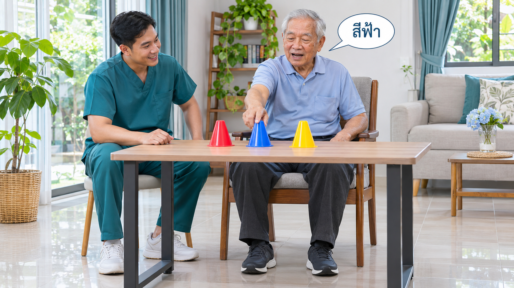

บางครั้งในชั่วโมงการรักษา นักกายภาพบำบัดให้ผู้ป่วยเอื้อมหยิบของพร้อมบอกสี หรือนั่งทรงตัวพร้อมตอบคำถามสั้น ๆ ญาติอาจสงสัยว่า “ทำไมไม่ฝึกแขนหรือฝึกนั่งอย่างเดียว?” คำตอบคือเรากำลังดูว่าผู้ป่วยแบ่งความสนใจให้การเคลื่อนไหวและงานคิดไปพร้อมกันได้เพียงใด ไม่ใช่เพียงทำให้ท่ายากขึ้นหรือให้ตอบได้เร็วที่สุด

<h3>สรุปสำหรับครอบครัว</h3>
<strong>Dual-task คือการทำสองงานร่วมกัน</strong> ในบทความนี้หมายถึงงานเคลื่อนไหวควบคู่กับงานคิด เช่น เอื้อมหยิบพร้อมบอกสี เป้าหมายคือฝึกจัดการความสนใจโดยยังควบคุมท่าทางได้ แต่ถ้าเพิ่มงานคิดแล้วตัวเอนมาก หยุดขยับ หรือสับสน ควรลดความยากหรือกลับไปฝึกทีละงาน ไม่จำเป็นต้องทำสองอย่างพร้อมกันทุกครั้ง

<figure class="article-figure"><figcaption>ตัวอย่างงานเคลื่อนไหวร่วมกับการบอกสี ภาพสร้างเพื่ออธิบายแนวคิด ไม่ใช่ภาพผู้ป่วยจริงหรือโปรแกรมที่เหมาะกับทุกคน ระดับการช่วยประคองต้องปรับรายบุคคล</figcaption></figure>

<nav class="toc-box" aria-label="สารบัญบทความ"><h3>สารบัญ</h3><ol><li><a href="#what">Dual-task คืออะไร</a></li><li><a href="#thinking-movement">เกี่ยวกับสมาธิและการควบคุมการเคลื่อนไหวอย่างไร</a></li><li><a href="#cue-or-task">ต่างจากพูดกำกับตัวเองอย่างไร</a></li><li><a href="#examples">ตัวอย่างกิจกรรมและการปรับระดับ</a></li><li><a href="#check-both">ดูทั้งคำตอบและท่าทาง</a></li><li><a href="#evidence">หลักฐานบอกอะไร และยังตอบอะไรไม่ได้</a></li><li><a href="#safety">ข้อควรระวังและเช็กลิสต์ผู้ดูแล</a></li></ol></nav>

<h2 id="what">1. Dual-task คืออะไร?</h2>

<strong>Cognitive–motor dual-task training</strong> คือการฝึกงานที่ใช้ความคิดไปพร้อมกับงานเคลื่อนไหว เช่น นับเลขต่อเนื่องขณะเอื้อมย้ายของ หรือบอกชื่อสีขณะหยิบกรวย งานคิดอาจใช้สมาธิ ความจำระยะสั้น หรือการเลือกคำตอบ ส่วนงานเคลื่อนไหวอาจเป็นการเอื้อม การควบคุมท่านั่ง หรือการเดิน ไม่ได้จำกัดเฉพาะการเดินเท่านั้น <a href="#ref1">[1]</a><a href="#ref2">[2]</a>

การนับเลขให้จบแล้วค่อยเอื้อม เป็นการทำสองงานตามลำดับ ซึ่งใช้เป็นขั้นเตรียมได้ แต่ยังไม่เหมือนการทำสองงานพร้อมกัน ส่วนการเลือกหยิบของตามสีเพียงอย่างเดียวอาจเป็นงานเอื้อมที่ต้องตัดสินใจ ไม่จำเป็นต้องเรียกว่า dual-task เสมอไป นักกายภาพจึงต้องดูว่าฝึกอะไรเพิ่มจากงานเดิมจริง ๆ

<h2 id="thinking-movement">2. ฝึกคิดแล้วเกี่ยวกับการเคลื่อนไหวอย่างไร?</h2>

ชีวิตประจำวันไม่ได้มีเพียง “ยกแขนให้ได้” เรายังต้องมองหาแก้ว จำว่าจะวางไว้ตรงไหน และฟังคนเรียก การควบคุมการเคลื่อนไหวหรือ <strong>motor control</strong> จึงเกี่ยวข้องกับการเลือกเป้าหมายและปรับการเคลื่อนไหวให้เหมาะกับสถานการณ์ด้วย

แต่ความสนใจมีขีดจำกัด เมื่อเพิ่มโจทย์คิด บางคนขยับช้าลง บางคนตอบผิด หรือหยุดเคลื่อนไหวเพื่อคิดก่อน สิ่งนี้เรียกว่า <strong>การรบกวนกันระหว่างสองงาน</strong> ไม่ควรรีบตีความว่าไม่ตั้งใจ การฝึกมีหน้าที่หาความยากที่พอเรียนรู้ได้โดยยังปลอดภัย ไม่ใช่ทำให้สมองยุ่งที่สุด <a href="#ref1">[1]</a>

<h2 id="cue-or-task">3. “พูดไปทำไป” ทุกแบบเป็น Dual-task หรือไม่?</h2>

<strong>ไม่เสมอไป</strong> ลองเทียบสองตัวอย่างนี้:

<ul><li><strong>พูดกำกับงานเดิม:</strong> พูดว่า “วางเท้า–โน้มตัว–ดันขึ้น” เพื่อช่วยจำขั้นตอนลุกยืน จุดประสงค์คือช่วยจัดลำดับงาน อ่านเพิ่มเรื่อง <a href="/blog/post.html?slug=verbal-self-instruction-stroke-rehab">การพูดกำกับตัวเองระหว่างฝึก</a></li><li><strong>เพิ่มงานคิดอีกอย่าง:</strong> นับเลขที่ไม่ใช่แค่การนับจำนวนครั้งของท่า ขณะเอื้อมย้ายของ จุดประสงค์คือฝึกแบ่งความสนใจให้ทั้งสองงาน</li></ul>

การบอกสีขณะหยิบอาจเป็นได้ทั้งตัวช่วยชี้เป้าหมายและงานคิดร่วม ขึ้นกับวิธีจัดโจทย์ จึงไม่ตัดสินจากการมีเสียงพูดเพียงอย่างเดียว และถ้าการเคลื่อนไหวพื้นฐานยังต้องใช้สมาธิมาก การใช้คำบอกสั้น ๆ ทีละขั้นอาจเหมาะกว่าการเพิ่มโจทย์คิด

<h2 id="examples">4. ตัวอย่างกิจกรรม: เริ่มจากระดับที่ควบคุมได้</h2>

<strong>ตัวอย่างต่อไปนี้ใช้เพื่อเข้าใจหลักการ ไม่ใช่ชุดการบ้านให้ทุกคนเริ่มเอง</strong> นักกายภาพจะเลือกท่า ระดับการช่วย และระยะฝึกตามการประเมิน หากยังนั่งเองไม่มั่นคง ต้องจัดการประคองก่อนเพิ่มโจทย์คิด

<h3>เอื้อมหยิบพร้อมบอกสี</h3>
เริ่มจากของชิ้นใหญ่ เบา และอยู่ใกล้ตัว ให้เอื้อมในช่วงที่ไม่ปวด หากทำงานเอื้อมได้แล้วจึงลองเพิ่มการบอกสีระหว่างหยิบ เมื่อสับสน อาจลดจำนวนสีหรือแยกบอกสีกับเอื้อมออกจากกันก่อน ไม่เพิ่มระยะเอื้อมและจำนวนสีพร้อมกัน

<h3>นั่งทรงตัวพร้อมนับเลขง่าย ๆ</h3>
จัดที่นั่งให้มั่นคง เท้ามีที่รองรับ และมีผู้ช่วยตามความจำเป็น ทดลองนับเลขในระดับที่คุ้นเคยขณะคงท่านั่ง นักกายภาพสังเกตว่าพอเริ่มคิดแล้วลำตัวเอนหรือไม่ หากเอนมากขึ้น ให้หยุดโจทย์คิดและกลับมาตั้งท่านั่งก่อน อ่านเรื่อง <a href="/blog/post.html?slug=trunk-control-older-adults">การควบคุมลำตัว</a> ประกอบได้

<h3>เมื่อพร้อมจึงพิจารณางานยืนหรือเดิน</h3>
การทำได้ในท่านั่งไม่ได้แปลว่าพร้อมทำขณะเดิน นักกายภาพต้องประเมินการทรงตัว อุปกรณ์ช่วยเดิน และความเสี่ยงล้มอีกครั้ง <strong>ไม่ทดลองเดินพร้อมคิดเลขตามลำพังเมื่อยังเดินไม่มั่นคง</strong> การฝึกงานเดียวให้มั่นคงยังเป็นส่วนสำคัญ ไม่ใช่ขั้นที่ต้องรีบข้าม <a href="#ref3">[3]</a>

<h2 id="check-both">5. จะรู้ว่าฝึกเหมาะหรือยากเกินไปได้อย่างไร?</h2>

ลองเปรียบเทียบงานเดิมเมื่อทำทีละอย่างกับเมื่อทำร่วมกัน โดยใช้ของ ระยะ และระดับช่วยใกล้เคียงกัน แล้วดู <strong>ทั้งสองด้าน</strong> ไม่ใช้จำนวนครั้งหรือความเร็วเพียงอย่างเดียว:

<ul><li><strong>ด้านเคลื่อนไหว:</strong> ยังเอื้อมถึงเป้าและกลับท่าเริ่มได้หรือไม่ มีตัวเอน ยักไหล่ ปวดเพิ่ม หรือใช้แรงช่วยมากขึ้นไหม</li><li><strong>ด้านความคิด:</strong> เข้าใจกติกาหรือไม่ บอกสีหรือนับต่อได้ไหม ต้องเตือนบ่อยขึ้นหรือหยุดตอบไปเลยหรือเปล่า</li><li><strong>ด้านความพร้อม:</strong> เหนื่อย เครียด หงุดหงิด หรือจำเป็นต้องพักมากขึ้นไหม</li></ul>

<strong>ตอบถูก แต่เกือบเสียหลัก ไม่ถือว่าเหมาะกับระดับนี้</strong> และขยับได้มากขึ้นแต่ไม่ทำงานคิดเลย ก็ยังสรุปไม่ได้ว่าทำสองงานได้ดีขึ้น เมื่อปลอดภัยและทำได้สม่ำเสมอ จึงค่อยปรับความยากทีละอย่างร่วมกับนักกายภาพ

ผู้ที่มีปัญหาการพูด การเข้าใจภาษา การมองเห็น หรือการได้ยิน อาจต้องเปลี่ยนรูปแบบโจทย์ ไม่ใช้การตอบช้าหรือบอกสีไม่ได้เป็นข้อสรุปว่าความจำไม่ดี การชี้หรือเลือกภาพอาจช่วยสื่อสารได้ แต่ก็เปลี่ยนความต้องการของงาน นักกายภาพจึงต้องเลือกวิธีวัดให้เหมาะสม

<h2 id="evidence">6. หลักฐานสนับสนุนแค่ไหน?</h2>

งานทบทวนการทดลองในผู้ป่วย <a href="/blog/post.html?slug=stroke-ep1">Stroke</a> พบแนวโน้มประโยชน์ของการฝึกสองงานต่อการทรงตัวและผลลัพธ์บางด้าน แต่ไม่ได้ดีขึ้นทุกตัวชี้วัด งานทบทวนปี 2024 ประเมินความเชื่อมั่นของหลักฐานไว้ต่ำถึงต่ำมาก ส่วนงานปี 2025 พบผลเชิงบวกบางด้านเช่นกัน แต่ไม่พบความแตกต่างชัดเจนในความเร็วเดินและการเคลื่อนไหวพื้นฐานบางแบบ <a href="#ref1">[1]</a><a href="#ref2">[2]</a>

<strong>จึงยังไม่ควรสรุปว่า “ฝึกคิดแล้วการเคลื่อนไหวจะดีขึ้นแน่นอน”</strong> หลักฐานจำนวนมากศึกษาเรื่องการทรงตัวหรือการเดินหลัง Stroke ไม่ได้พิสูจน์โดยตรงว่าการหยิบกรวยพร้อมบอกสีจะทำให้แขนฟื้นในทุกคน หรือให้ผลเท่ากันในผู้ป่วยหลังผ่าตัดสมองและโรคทางระบบประสาทอื่น ตัวอย่างในบทความเป็นแนวทางอธิบายการจัดกิจกรรม ต้องติดตามผลจริงของแต่ละคน

<h2 id="safety">7. เช็กลิสต์สำหรับผู้ดูแล</h2>
<ul><li>ใช้เฉพาะกิจกรรมที่นักกายภาพจัดให้ ไม่เปลี่ยนจากนั่งเป็นยืนหรือเดินเอง</li><li>เลือกที่นั่งมั่นคง ไม่มีล้อ เท้ามีที่รองรับ และจัดผู้ช่วยตามระดับที่ต้องใช้ <a href="#ref4">[4]</a></li><li>ลดเสียงทีวีและสิ่งรบกวน บอกโจทย์สั้น ๆ และให้เวลาตอบ</li><li>ถ้าเริ่มคุมท่าไม่ได้ ให้หยุดโจทย์คิด ตั้งท่าใหม่ และลดเหลืองานเดียว</li><li>พักเมื่อปวด เวียนหัว หรือเหนื่อยผิดปกติ หากอาการไม่ดีขึ้นหรือเกิดซ้ำ ให้ติดต่อทีมรักษา</li><li>จดสั้น ๆ ว่าอะไรทำได้ อะไรทำให้ท่าเสีย และต้องช่วยมากขึ้นตรงไหน เพื่อนำไปปรับครั้งต่อไป</li></ul>

<strong>อาการใหม่ฉับพลันไม่ใช่โจทย์ฝึกที่ยากเกินไปเสมอไป:</strong> หากหน้าเบี้ยว แขนขาอ่อนแรงเพิ่มทันที พูดไม่ชัดหรือสับสนผิดจากเดิมฉับพลัน ให้หยุดฝึกและขอความช่วยเหลือฉุกเฉินทันที แม้อาการจะหายไปเอง ไม่รอดูผลจากการพักฝึก <a href="#ref5">[5]</a>

<h3>ข้อควรจำ</h3>
Dual-task ไม่ใช่การแข่งขันตอบคำถามขณะออกกำลัง แต่เป็นการฝึกให้ความคิดและการเคลื่อนไหวทำงานร่วมกันในระดับที่เหมาะ เริ่มจากสิ่งที่ทำได้ ดูทั้งคำตอบและคุณภาพท่า แล้วค่อยเพิ่มความท้าทาย เป้าหมายคือใช้ความสามารถได้จริงอย่างปลอดภัย ไม่ใช่ทำหลายอย่างให้มากที่สุด

<h2 id="references">เอกสารอ้างอิง</h2>
<ol><li id="ref1"><a href="https://link.springer.com/article/10.1186/s12984-024-01507-6" target="_blank" rel="noopener noreferrer">Zhang และคณะ (2024). Cognitive-motor dual-task training on gait and balance in stroke patients. Journal of NeuroEngineering and Rehabilitation.</a> แนวคิดสองงาน ผลต่อการทรงตัว และความไม่แน่นอนของหลักฐาน</li><li id="ref2"><a href="https://pmc.ncbi.nlm.nih.gov/articles/PMC12261537/" target="_blank" rel="noopener noreferrer">Mou และ Jiang (2025). Effect of dual task-based training on motor and cognitive function in stroke patients. BMC Neurology.</a> งานทบทวนผลด้านการเคลื่อนไหวและการรู้คิดหลัง Stroke ไม่ใช่การรับรองตัวอย่างกิจกรรมเฉพาะในบทความนี้</li><li id="ref3"><a href="https://www.strokeguideline.org/chapter/motor-recovery-and-physical-effects-of-stroke/" target="_blank" rel="noopener noreferrer">National Clinical Guideline for Stroke (2023): Motor recovery and physical effects of stroke.</a> การเลือกการฝึกตามรายบุคคล การประเมินการทรงตัวและการล้ม</li><li id="ref4"><a href="https://www.nhs.uk/live-well/exercise/sitting-exercises/" target="_blank" rel="noopener noreferrer">NHS: Sitting exercises.</a> หลักจัดที่นั่งมั่นคงและปรับระดับ ไม่ใช่โปรแกรม dual-task เฉพาะบุคคล</li><li id="ref5"><a href="https://www.nhs.uk/conditions/stroke/symptoms/" target="_blank" rel="noopener noreferrer">NHS: Symptoms of a stroke.</a> อาการเตือนที่ต้องขอความช่วยเหลือฉุกเฉิน</li></ol>

<small>เรียบเรียงด้วยความช่วยเหลือของ AI โดยอ้างอิงแหล่งข้อมูลข้างต้น ข้อมูลเพื่อความเข้าใจทั่วไป ไม่แทนการประเมินเฉพาะบุคคล และไม่เพิ่มหรือเปลี่ยนโปรแกรมฝึกที่ได้รับอยู่โดยอัตโนมัติ</small>

