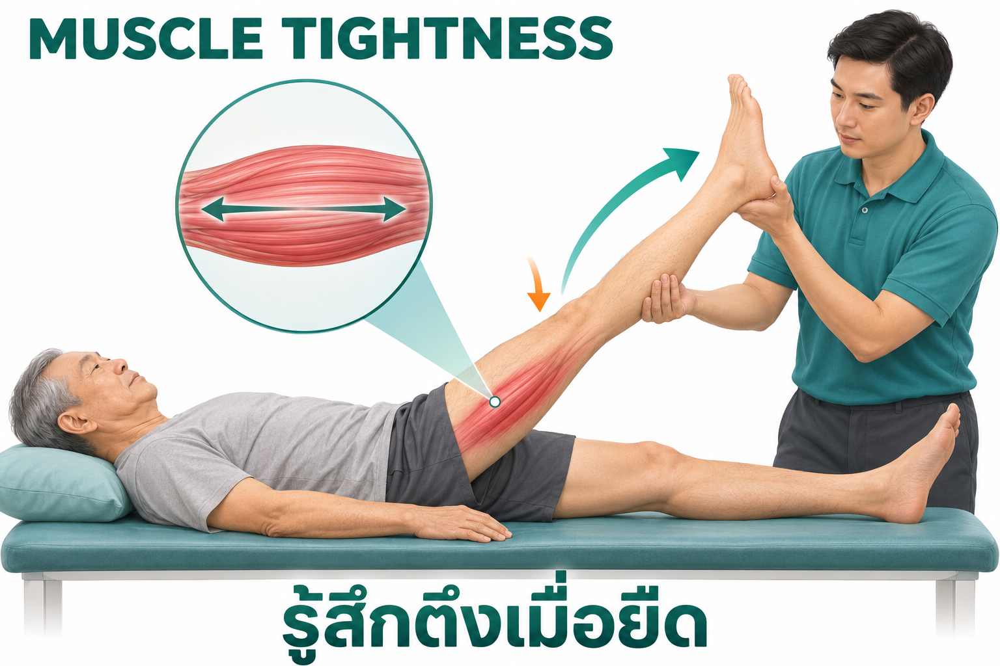
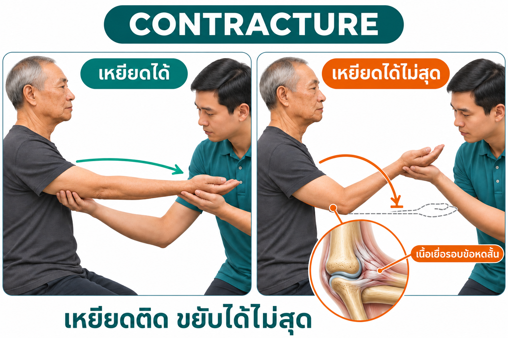
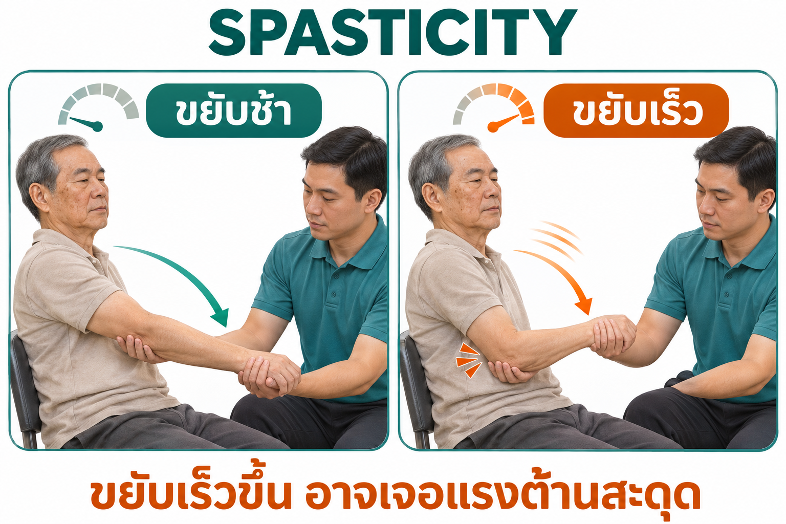
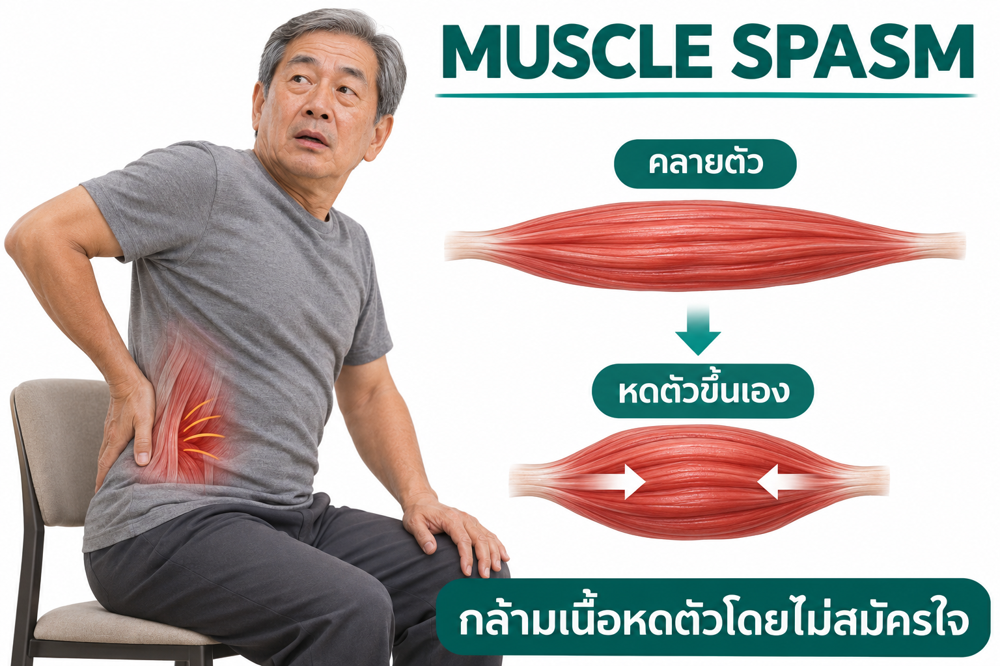
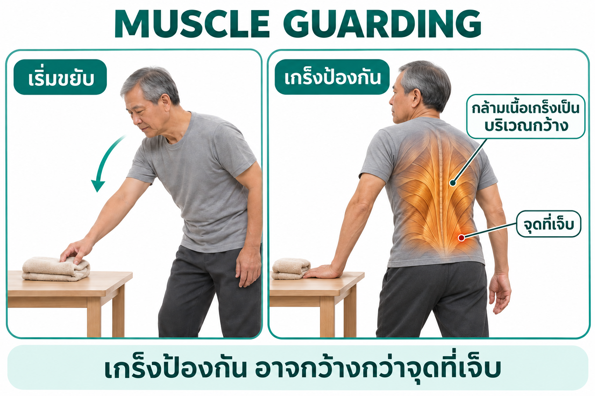

<h2 id="purpose">จุดประสงค์ของบทความ</h2>
บทความนี้จัดทำขึ้นเพื่ออธิบายนิยามและความแตกต่างของความผิดปกติหรือความบกพร่องในการทำงานของกล้ามเนื้อ พร้อมยกตัวอย่างผ่านมุมมองและคำอธิบายส่วนตัวของนักกายภาพบำบัด เพื่อช่วยให้เข้าใจและเชื่อมโยงกับสถานการณ์ทางคลินิกได้ง่ายขึ้น

ตัวอย่างเหล่านี้ใช้เพื่อประกอบการสอน ไม่ใช่นิยามมาตรฐาน และอาจอธิบายอย่างย่อหรือเน้นเฉพาะบางแง่มุมเพื่อให้เห็นภาพ

<nav class="toc-box" aria-label="สารบัญ"><h3>คำศัพท์ในบทความ</h3><ol><li><a href="#tightness">Muscle tightness</a></li><li><a href="#contracture">Contracture</a></li><li><a href="#spasticity">Spasticity</a></li><li><a href="#rigidity">Rigidity</a></li><li><a href="#spasm">Muscle spasm</a></li><li><a href="#guarding">Muscle guarding</a></li><li><a href="#references">เอกสารอ้างอิง</a></li></ol></nav>
ภาพจำลองประกอบคำอธิบาย ไม่ใช่ภาพผู้ป่วยจริงหรือวิธีตรวจด้วยตนเอง

<section class="term-section" aria-labelledby="tightness">
<h2 id="tightness">1. Muscle tightness — ความตึงของกล้ามเนื้อ</h2><figure class="concept-figure" data-term="tightness"><figcaption>Tightness: ความตึงที่นักกายภาพรู้สึกขณะยืดกล้ามเนื้อ ในภาพคือด้านหลังต้นขา <a href="#ref2">[2]</a></figcaption></figure>

<h3>นิยาม</h3>

Tightness เป็นคำบรรยายความรู้สึกตึงหรือความยืดขยายที่ลดลง จึงต้องระบุว่าเป็นอาการที่ผู้ป่วยรู้สึก หรือผลตรวจความยืดขยายของกล้ามเนื้อ คำนี้บอกลักษณะอาการหรือสิ่งตรวจพบ แต่ไม่ได้ระบุเนื้อเยื่อต้นเหตุ

ผลตรวจความยืดหยุ่นอาจเกี่ยวข้องทั้งกับคุณสมบัติของเนื้อเยื่อและการทนต่อความรู้สึกยืด งานของ Magnusson และคณะในคนสุขภาพดี 7 คนพบว่าช่วงข้อที่เพิ่มหลังโปรแกรมยืดสัมพันธ์กับการยอมรับความรู้สึกยืดได้มากขึ้น โดยไม่พบการเปลี่ยนคุณสมบัติทางกลตามตัวแปรที่วัดในงานนั้น เป็นหลักฐานว่าผลตรวจความยืดหยุ่นควรพิจารณาร่วมกับความรู้สึกยืด ไม่อธิบายด้วยโครงสร้างเพียงด้านเดียว <a href="#ref2">[2]</a>

<h3>ยกตัวอย่าง</h3>
เวลานักกายภาพยืดกล้ามเนื้อแล้วรู้สึกตึง ผมมองภาพว่ากล้ามเนื้ออยู่ในท่าสั้นนาน จน fascia รอบกล้ามเนื้อกระชับเข้ามา พอเรายืดจึงสัมผัสได้ถึงความตึงจากเนื้อเยื่อรอบ ๆ กล้ามเนื้อ ความตึงในตัวอย่างนี้คือสิ่งที่นักกายภาพรับรู้ขณะตรวจ

</section>

<section class="term-section" aria-labelledby="contracture">
<h2 id="contracture">2. Contracture — ภาวะหดสั้นติดของเนื้อเยื่อ</h2><figure class="concept-figure" data-term="contracture"><figcaption>Contracture: เหยียดติดแม้มีผู้ช่วยขยับ ภาพขยายแสดงตัวอย่างเนื้อเยื่อรอบข้อที่หดสั้น <a href="#ref3">[3]</a></figcaption></figure>

<h3>นิยาม</h3>

Contracture คือข้อที่ขยับได้ไม่สุด แม้มีผู้ช่วยขยับให้ (passive) เพราะกล้ามเนื้อ เอ็น เยื่อหุ้มข้อ หรือเนื้อเยื่อรอบข้อเปลี่ยนแปลงจนจำกัดช่วงการเคลื่อนไหว <a href="#ref3">[3]</a>

<h3>ยกตัวอย่าง</h3>
นึกถึงยางเส้นแข็งที่ยืดได้จำกัด เมื่อค่อย ๆ ดึงเข้าใกล้ปลายช่วงจะรู้สึกต้านมากขึ้น พอลดแรงดึง แรงต้านที่มือรับรู้ก็ลดลง แต่ข้อจำกัดจากเนื้อเยื่อยังอยู่ ไม่ได้หายไปเพียงเพราะคนไข้ผ่อนคลาย

ภาพเปรียบเทียบนี้ช่วยแยกความยึดติดของเนื้อเยื่อออกจากการเกร็งเป็นช่วง ๆ ไม่ใช่คำแนะนำให้เพิ่มแรงจนฝืนข้อให้หลุดจากจุดที่ติด <a href="#ref3">[3]</a>

</section>

<section class="term-section" aria-labelledby="spasticity">
<h2 id="spasticity">3. Spasticity — ภาวะเกร็งที่สัมพันธ์กับความเร็วของการยืด</h2><figure class="concept-figure" data-term="spasticity"><figcaption>Spasticity: ขยับเร็วขึ้น อาจพบแรงต้านสะดุด (catch) <a href="#ref4">[4]</a></figcaption></figure>

<h3>นิยาม</h3>

ตามนิยามของ Lance, spasticity เป็นความผิดปกติที่มี tonic stretch reflex เพิ่มขึ้นตามความเร็วของการยืด จากการตอบสนองของ stretch reflex ที่มากเกินไป และเป็นองค์ประกอบหนึ่งของ upper motor neuron syndrome <a href="#ref4">[4]</a><a href="#ref6">[6]</a>

<h3>ยกตัวอย่าง</h3>
เวลาฝึกขยับแขนหรือขา ผมจะช่วยคุมจังหวะและความเร็วให้ช้า นุ่มนวล และไม่กระชาก เพื่อลดการยืดกล้ามเนื้ออย่างรวดเร็วที่อาจกระตุ้นแรงต้านแบบ spasticity หากเริ่มต้านมากขึ้น ก็ปรับความเร็ว ช่วงการเคลื่อนไหว และท่าให้เหมาะ

การคุมความเร็วเป็นส่วนหนึ่งของการฝึก ไม่ได้ป้องกันการเกร็งได้ทุกครั้ง และยังต้องดูสิ่งกระตุ้นอื่นร่วมด้วย เช่น ความเจ็บปวดหรือท่าที่ไม่สบาย <a href="#ref4">[4]</a><a href="#ref9">[9]</a>

</section>

<section class="term-section" aria-labelledby="rigidity">
<h2 id="rigidity">4. Rigidity — ภาวะแข็งเกร็ง</h2><figure class="concept-figure" data-term="rigidity"><figcaption>Rigidity: ฝืดต้านแม้ขยับช้า อาจต่อเนื่องแบบท่อ หรือสะดุดเป็นจังหวะแบบเฟือง <a href="#ref4">[4]</a></figcaption></figure>

<h3>นิยาม</h3>

Rigidity คือแรงต้านต่อการเคลื่อนไหวแบบ passive ที่เพิ่มขึ้น โดยลักษณะการตรวจคลาสสิกยังรู้สึกต้านได้เมื่อเคลื่อนช้า มักพบทั้งทิศงอและเหยียด และมีแรงต้านที่ค่อนข้างสม่ำเสมอตลอดช่วงการเคลื่อนไหว รูปแบบแรงต้านอาจจำแนกได้ดังนี้ <a href="#ref4">[4]</a>

<ul><li><strong>Lead-pipe rigidity:</strong> แรงต้านค่อนข้างต่อเนื่องและสม่ำเสมอ</li><li><strong>Cogwheel rigidity:</strong> แรงต้านสะดุดเป็นช่วงคล้ายเฟือง ซึ่งอาจเกิดจากการสั่นที่ซ้อนกับ rigidity</li></ul>

กลไกเกี่ยวข้องกับวงจรควบคุมการเคลื่อนไหว รวมถึง basal ganglia วงจรเชื่อมต่อ และการควบคุมการตอบสนองของรีเฟล็กซ์ <a href="#ref1">[1]</a><a href="#ref4">[4]</a>

<h3>ยกตัวอย่าง</h3>
ตัวอย่างคือผู้ป่วยพาร์กินสันที่แขนขาฝืดแข็ง แม้พยายามผ่อนคลาย ระหว่างขยับอาจต้านต่อเนื่องคล้ายดัดท่อ หรือสะดุดเป็นจังหวะคล้ายเฟือง โดยไม่จำเป็นต้องขยับเร็ว

บางรายความแข็งเกร็งดีขึ้นหลังได้รับยาพาร์กินสัน เช่น levodopa ตามแผนของแพทย์ จึงไม่ควรคาดหวังให้เทคนิคคลายหรือยืดทางกายภาพแก้ได้เพียงอย่างเดียว กายภาพยังช่วยเรื่องความยืดหยุ่น การเคลื่อนไหว และการทำกิจวัตรร่วมกับการรักษาด้วยยา <a href="#ref4">[4]</a><a href="#ref8">[8]</a>

</section>

<section class="term-section" aria-labelledby="spasm">
<h2 id="spasm">5. Muscle spasm — การหดตัวของกล้ามเนื้อโดยไม่สมัครใจ</h2><figure class="concept-figure" data-term="spasm"><figcaption>Spasm: กล้ามเนื้อหดตัวเองโดยไม่สมัครใจ อาจปวดหรือไม่ปวดก็ได้ <a href="#ref6">[6]</a></figcaption></figure>

<h3>นิยาม</h3>

Muscle spasm ใช้บรรยายการหดตัวของกล้ามเนื้อโดยไม่สมัครใจ อาจเกิดเป็นช่วงหรือคงอยู่ ความหมายต้องอ่านร่วมกับบริบท ไม่จำเป็นต้องเจ็บรุนแรงหรือมีการอักเสบทุกครั้ง ในภาวะทางระบบประสาทอาจพบการหดตัวแบบงอหรือเหยียดที่เกิดตามสิ่งกระตุ้นได้ <a href="#ref6">[6]</a>

<h3>ยกตัวอย่าง</h3>
เวลาเจอคนไข้ปวดหลังแล้วกล้ามเนื้อ paravertebral เกร็ง ผมจะหาสาเหตุที่ทำให้เกร็ง เช่น ในกรณีที่ทำ mobilization บริเวณหลังแล้วกล้ามเนื้อคลายลง การรักษาจึงต้องมองไปถึงปัญหาที่กระตุ้นให้กล้ามเนื้อเกร็งด้วย

</section>

<section class="term-section" aria-labelledby="guarding">
<h2 id="guarding">6. Muscle guarding — การเกร็งป้องกัน</h2><figure class="concept-figure" data-term="guarding"><figcaption>Guarding: เกร็งป้องกันเมื่อเจ็บหรือคาดว่าจะเจ็บ ภาพตัวอย่างแสดงบริเวณเกร็งที่กว้างกว่าจุดปวด <a href="#ref5">[5]</a></figcaption></figure>

<h3>นิยาม</h3>

Guarding คือการเกร็งป้องกันเมื่อเจ็บหรือคาดว่าจะเจ็บ จึงขยับน้อยลง และอาจทำให้ช่วงข้อที่ตรวจได้ลดลง

Hollmann และคณะศึกษาผู้มีภาวะไหล่ติด 5 คน พบว่าหลังให้ยาระงับความรู้สึกทั่วไป ช่วงข้อเพิ่มขึ้นในบางทิศทาง จึงเป็นไปได้ว่า guarding มีส่วนจำกัดการเคลื่อนไหวในบางราย แต่การศึกษาขนาดเล็กนี้ยังสรุปแทนผู้ป่วยทุกคนไม่ได้ <a href="#ref5">[5]</a>

<h3>ยกตัวอย่าง</h3>
เมื่อกระดูกหัก กล้ามเนื้อรอบบริเวณบาดเจ็บอาจเกร็งป้องกันเพื่อจำกัดการเคลื่อนไหว หากฝืนขยับจนรอยหักที่ยังไม่มั่นคงหรือเนื้อเยื่อรอบ ๆ ถูกกระตุ้น อาจปวดมากขึ้นและเกร็งตามมาอีก จึงต้องประเมินและดูแลกระดูกให้มั่นคงก่อน ไม่มุ่งคลายกล้ามเนื้อเพียงอย่างเดียว <a href="#ref7">[7]</a>

จุดที่ผมต้องการสื่อคือ บางครั้งกล้ามเนื้อกำลังปกป้องส่วนที่บาดเจ็บ และบริเวณเกร็งอาจกว้างกว่าจุดปวด การดูแลจึงต้องหาสาเหตุที่กระตุ้นให้เกร็ง ไม่ใช่เห็นตึงแล้วพยายามคลายทุกกรณี

</section>

<h2 id="references">เอกสารอ้างอิง</h2>
นิยามแปลและเรียบเรียงจากแหล่งอ้างอิงต่อไปนี้ โดยระบุประเภทและข้อจำกัดของหลักฐานไว้ประกอบการอ่าน
<ol class="references">

<li id="ref1"><a href="https://www.mdpi.com/2072-6651/13/4/282">Ganguly J และคณะ (2021). Muscle Tone Physiology and Abnormalities. Toxins, 13, 282.</a> บทความทบทวนสรีรวิทยา tone และกลไก rigidity</li>
<li id="ref2"><a href="https://doi.org/10.1113/jphysiol.1996.sp021768">Magnusson SP และคณะ (1996). A mechanism for altered flexibility in human skeletal muscle. Journal of Physiology, 497, 291–298.</a> งานทดลองในคนสุขภาพดี 7 คน ใช้แสดงความต่างของ stretch tolerance กับคุณสมบัติทางกล ไม่เหมารวมถึง Stroke</li>
<li id="ref3"><a href="https://doi.org/10.1002/mus.26845">Nuckolls GH และคณะ (2020). Conference report on contractures in musculoskeletal and neurological conditions. Muscle &amp; Nerve, 61, 740–744.</a> รายงานประชุมวิชาการเกี่ยวกับ contracture และความหลากหลายของเนื้อเยื่อ/กลไก ไม่ใช่แนวทางรักษาเดียว</li>

<li id="ref4"><a href="https://pmc.ncbi.nlm.nih.gov/articles/PMC6183506/">Fearon C, Doherty L, Lynch T (2015). How Do I Examine Rigidity and Spasticity? Movement Disorders Clinical Practice, 2, 204.</a> บทความสอนการตรวจและแยกรูปแบบแรงต้าน ไม่ใช่งานประสิทธิผลการรักษา</li>
<li id="ref5"><a href="https://researchprofiles.canberra.edu.au/en/publications/does-muscle-guarding-play-a-role-in-range-of-motion-loss-in-patie/">Hollmann L และคณะ (2018). Does muscle guarding play a role in range of motion loss in patients with frozen shoulder? Musculoskeletal Science and Practice, 37, 64–68.</a> รายงานผู้ป่วย 5 คน; ตรวจบทคัดย่อจากสถาบันผู้วิจัย ยังไม่ได้ตรวจบทความเต็มจากสำนักพิมพ์</li>
<li id="ref6"><a href="https://pmc.ncbi.nlm.nih.gov/articles/PMC4229996/">Trompetto C และคณะ (2014). Pathophysiology of Spasticity: Implications for Neurorehabilitation. BioMed Research International, 2014, 354906.</a> บทความทบทวนเพื่ออธิบายนิยาม องค์ประกอบทางประสาท และเนื้อเยื่อ</li>
<li id="ref7"><a href="https://www.merckmanuals.com/home/injuries-and-poisoning/fractures/overview-of-fractures">Merck Manual Consumer Version. Overview of Fractures.</a> ข้อมูลกระดูกหักสำหรับประชาชน อธิบายอาการเกร็งรอบรอยหัก ความปวด และการดูแลความมั่นคงของกระดูก ไม่ได้ยืนยันว่าการคลายกล้ามเนื้อทำให้กระดูกแยกในทุกกรณี</li><li id="ref8"><a href="https://www.parkinsons.org.uk/information/symptoms/motor/rigidity">Parkinson's UK. Rigidity.</a> ข้อมูลผู้ป่วยเรื่องความแข็งเกร็ง การรักษาด้วยยา และกายภาพบำบัด ไม่ใช่งานเปรียบเทียบว่าวิธีใดดีกว่าในทุกคน</li><li id="ref9"><a href="https://www.ouh.nhs.uk/media/oy0jcnfx/105522spasticity.pdf">Oxford University Hospitals NHS Foundation Trust. Physical management of spasticity.</a> เอกสารแนะนำผู้ป่วยเรื่องการยืดอย่างช้าและนุ่มนวล การจัดท่า และการดูแลร่วมกับผู้รักษา</li></ol>
